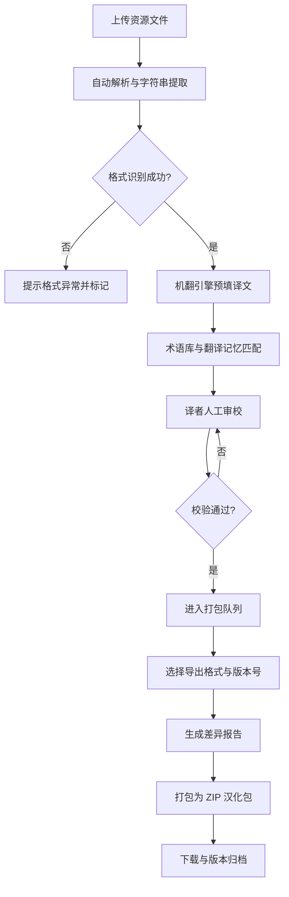

## 1. 产品概述

「译核 · TransCore」是一个面向开发者与本地化团队的软件汉化包生成平台，支持任意格式资源文件（JSON / XML / properties / INI / PO / YAML / RESX 等）的解析、翻译、审校与一键打包发布。

- **核心定位**：从"上传原始资源文件"到"下载可部署汉化包"的全流程一站式工作台，覆盖解析、机翻预填、人工审校、术语统一、差异比对、打包发布全链路。
- **目标用户**：独立开发者、开源汉化组、企业本地化团队、技术爱好者（如 GROMACS 等科研软件用户）。
- **市场价值**：消除"汉化"这件事在格式适配、术语一致性、版本同步上的重复劳动，让任意软件在数分钟内得到高质量中文版本。

## 2. 核心功能

### 2.1 用户角色
| 角色 | 使用方式 | 核心权限 |
|------|----------|----------|
| 普通译者 | 免登录体验 | 创建项目、上传文件、机翻预填、人工编辑、下载汉化包 |
| 项目负责人 | 项目内授权 | 术语库管理、翻译记忆维护、发布版本锁定、成员协同 |
| 汉化组管理员 | 平台级授权 | 跨项目模板复用、全局术语库、批量打包任务 |

### 2.2 功能模块
1. **工作台首页**：数据概览、近期项目、进行中任务、快捷入口
2. **项目管理**：项目列表、新建项目向导、版本管理、导入导出
3. **翻译工作台**：文件树 + 字符串列表 + 双栏编辑器 + 实时预览
4. **术语库与翻译记忆**：术语管理、记忆库复用、自动匹配提示
5. **打包发布**：格式选择、差异报告、版本锁定、一键导出汉化包

### 2.3 页面详情
| 页面名称 | 模块名称 | 功能描述 |
|----------|----------|----------|
| 工作台首页 | 数据看板 | 字符串总量、已翻译率、待审校数、术语命中率实时统计 |
| 工作台首页 | 近期项目 | 卡片式展示最近 6 个项目及进度环 |
| 工作台首页 | 任务流 | 进行中的翻译/审校/打包任务时间轴 |
| 项目管理 | 项目列表 | 表格视图，支持筛选、排序、批量操作 |
| 项目管理 | 新建向导 | 三步式创建：基本信息 → 上传资源 → 选择格式策略 |
| 项目管理 | 版本时间线 | 历史版本对比、回滚、差异高亮 |
| 翻译工作台 | 文件树 | 左侧多级目录，支持格式图标与状态徽标 |
| 翻译工作台 | 字符串列表 | 中栏可筛选列表，显示原文/译文/状态/术语标记 |
| 翻译工作台 | 双栏编辑器 | 右栏原文-译文对照，术语悬浮提示、长度校验、历史版本 |
| 翻译工作台 | 实时预览 | 顶部抽屉式预览，模拟软件界面渲染译文 |
| 术语库 | 术语管理 | CRUD 表格，支持领域分类、上下文示例、禁译词 |
| 翻译记忆 | 记忆复用 | 模糊匹配（≥75%）自动建议，命中率高亮 |
| 打包发布 | 格式策略 | 原格式回写 / 统一 JSON / 多格式并存 |
| 打包发布 | 差异报告 | 新增/删除/修改字符串统计与可视化 |
| 打包发布 | 导出汉化包 | 版本号、README 自动生成、ZIP 下载 |

## 3. 核心流程

**主流程**：用户上传资源文件 → 平台自动解析识别可翻译字符串 → 调用机翻引擎预填译文 → 译者人工审校（结合术语库与翻译记忆）→ 校验通过后进入打包队列 → 选择导出格式与版本 → 生成 ZIP 汉化包下载。

## 4. 用户界面设计

### 4.1 设计风格
- **美学方向**：「技术蓝图 × 工业精密」—— 深色基底如工程图纸，青蓝主色象征"原文流"，琥珀辅色象征"译文流"，网格与坐标线强化精密感。
- **主色**：`#0A0E14` 深炭黑底 / `#121821` 面板层；`#22D3EE` 青蓝（原文/数据）；`#FBBF24` 琥珀（译文/高亮）；`#34D399` 翠绿（成功/完成）。
- **字体**：展示字体 `Space Grotesk`（标题）+ 等宽 `JetBrains Mono`（代码/字符串）+ 正文 `Inter` 替换为 `Sora`（正文）。中文字体回退 `PingFang SC` / `Microsoft YaHei`。
- **布局**：桌面优先，左侧固定导航 + 顶部状态栏 + 主内容区三段式；表格密集信息，卡片稀疏留白，形成节奏对比。
- **按钮**：主按钮实心青蓝带微光，次按钮线框，危险按钮琥珀描边；圆角 6px，统一高度 36px。
- **图标**：线性 SVG 图标（Lucide 风格），1.5px 描边；状态徽标用小圆点 + 文字。
- **氛围细节**：背景叠加 4% 噪点纹理 + 极淡网格线（0.5px / 5% 透明）；面板顶部 1px 青蓝渐变高光线；悬浮卡片有 12px 模糊投影。

### 4.2 页面设计概览
| 页面名称 | 模块名称 | UI 元素 |
|----------|----------|----------|
| 工作台首页 | Hero 数据看板 | 4 个大数字卡片 + 环形进度 + 迷你折线图，入场错峰动画 |
| 工作台首页 | 近期项目 | 网格卡片，悬浮提升 + 青蓝描边，进度环 SVG |
| 工作台首页 | 任务时间轴 | 垂直时间线，节点状态色，hover 展开详情 |
| 项目管理 | 项目表格 | 紧凑表格，行 hover 高亮，状态徽标，批量操作工具栏 |
| 项目管理 | 新建向导 | 居中模态，三步进度指示器，拖拽上传区 |
| 翻译工作台 | 三栏布局 | 左 240px 文件树 / 中 380px 字符串列表 / 右弹性编辑器 |
| 翻译工作台 | 双栏编辑器 | 原文灰底只读 + 译文可编辑，术语下划波浪线，字符计数条 |
| 翻译工作台 | 预览抽屉 | 顶部滑出，模拟软件 UI 框架渲染 |
| 术语库 | 术语表格 | 行内编辑，领域标签彩色，搜索高亮 |
| 打包发布 | 格式策略卡 | 三选一卡片选择，选中青蓝光晕 |
| 打包发布 | 差异报告 | 三栏统计 + 流程条形图 |
| 打包发布 | 导出按钮 | 大号主按钮，点击后生成进度环 → 下载 |

### 4.3 响应式
- **桌面优先**：≥1280px 完整三栏；1024-1280px 中栏折叠为抽屉；<1024px 显示"请在桌面端使用"引导（开发工具属性强）。
- **触控优化**：表格行高增至 48px，按钮间距扩大，支持滑动手势切换字符串。

### 4.4 3D 场景指引
本项目无 3D 场景需求，以信息密度与精密排版为核心。
