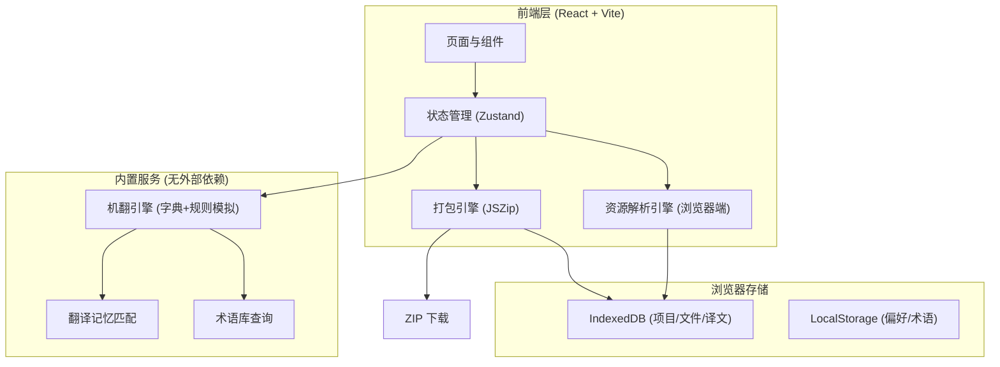
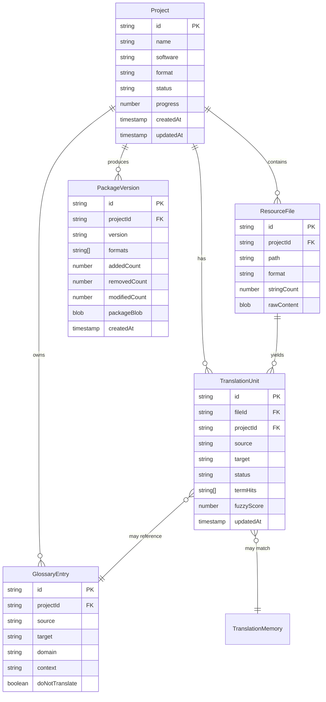

## 1. 架构设计



## 2. 技术说明
- **前端框架**：React@18 + Vite@5 + TypeScript
- **样式方案**：Tailwind CSS@3 + CSS 变量主题令牌
- **路由**：React Router@6（嵌套路由 + 布局路由）
- **状态管理**：Zustand（轻量、无 Provider）
- **资源解析**：浏览器端纯 JS 实现
  - JSON：原生 `JSON.parse`
  - YAML：`yaml` 库
  - XML / RESX：`fast-xml-parser`
  - properties / INI：自实现行解析器
  - PO / POT：自实现 gettext 解析器
- **打包**：`jszip` + `file-saver`
- **存储**：IndexedDB（通过 `idb` 封装），LocalStorage 存偏好
- **机翻引擎**：内置字典 + 规则模拟（常见 UI 词汇表 + 长度/标点规则），无外部 API 依赖
- **图表**：自绘 SVG（环形进度、迷你折线、条形图），避免重型图表库
- **图标**：`lucide-react`
- **字体**：Google Fonts 加载 `Space Grotesk` / `JetBrains Mono` / `Sora`
- **后端**：无（纯前端应用，数据落 IndexedDB，可后续扩展）

## 3. 路由定义
| 路由 | 用途 |
|------|------|
| `/` | 工作台首页（数据看板） |
| `/projects` | 项目管理列表 |
| `/projects/new` | 新建项目向导 |
| `/projects/:id` | 项目详情与版本时间线 |
| `/translate/:projectId` | 翻译工作台（三栏） |
| `/glossary/:projectId?` | 术语库管理 |
| `/package/:projectId` | 打包发布 |

## 4. 数据模型（IndexedDB Store）

### 4.1 数据模型定义


### 4.2 数据初始化
- 启动时若 IndexedDB 为空，注入演示项目「GROMACS 界面汉化」「VLC 播放器菜单汉化」「示例 JSON 应用」三个项目及对应字符串、术语、记忆数据。
- 内置通用 UI 术语字典约 200 条（File/Edit/View/Help/Save/Open/Exit 等高频词）。

## 5. 关键模块说明

### 5.1 资源解析引擎
统一抽象为 `Parser` 接口：
```ts
interface Parser {
  detect(content: ArrayBuffer | string, filename: string): boolean;
  parse(content: ArrayBuffer | string): TranslationUnit[];
  serialize(units: TranslationUnit[]): ArrayBuffer | string;
}
```
按格式注册到 `ParserRegistry`，上传时按 detect 优先级匹配。

### 5.2 机翻模拟引擎
- 第一步：术语库精确匹配（最长优先）
- 第二步：翻译记忆模糊匹配（≥85% 直接采用，75-85% 标记建议）
- 第三步：内置字典查表
- 第四步：未命中则保留原文并标记 `[未翻译]`

### 5.3 打包引擎
- 按原格式回写：调用对应 `Parser.serialize`
- 生成 `README.txt`（含版本、日期、字符串数、格式）
- 生成 `manifest.json`（项目元信息）
- JSZip 压缩为 `项目名_版本_汉化包.zip` 下载

## 6. 性能与体验
- 字符串列表虚拟滚动（`react-window`）支持万级条目
- 编辑器防抖保存 800ms
- IndexedDB 事务批量化写入
- 路由级代码分割（React.lazy）
